<div align="center">

# DNScope

### DNS Monitoring and Spoofing Detection System

**Observe. Compare. Investigate.**

Computer Networks · Assessment-8 · Anwita Padhi (24BYB0193) · VIT Vellore · 2026–2027


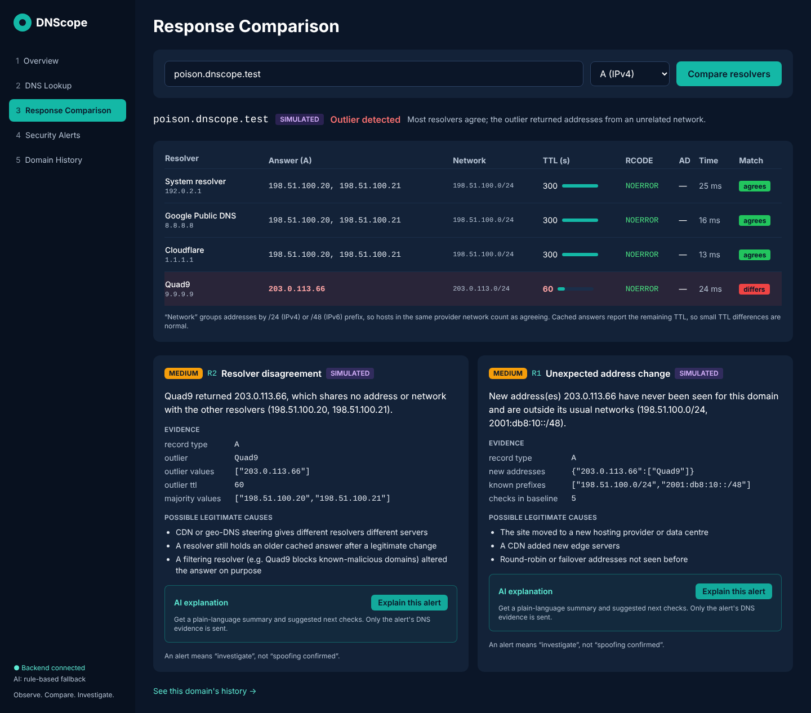

</div>

---

## Contents

1. [What DNScope does](#1-what-dnscope-does)
2. [Quick start](#2-quick-start)
3. [Background: how DNS works and where it can be attacked](#3-background-how-dns-works-and-where-it-can-be-attacked)
4. [System architecture](#4-system-architecture)
5. [What happens during one check](#5-what-happens-during-one-check)
6. [Detection rules R1–R6](#6-detection-rules-r1r6)
7. [Backend modules](#7-backend-modules)
8. [Database design](#8-database-design)
9. [AI assistant (optional)](#9-ai-assistant-optional)
10. [Dashboard pages](#10-dashboard-pages)
11. [Simulated test scenarios](#11-simulated-test-scenarios)
12. [API reference](#12-api-reference)
13. [Configuration](#13-configuration)
14. [Testing](#14-testing)
15. [Limitations](#15-limitations)
16. [Project structure](#16-project-structure)
17. [References](#17-references)

---

## 1. What DNScope does

**DNS (Domain Name System)** is the Internet's phonebook: it turns a name like `example.com` into the IP
address your computer connects to. If someone forges that answer, you are silently sent to the wrong server.
This is called **DNS spoofing** or **cache poisoning**.

Ordinary tools such as `nslookup` show one answer from one server at one moment. DNScope does more:

| | DNScope |
|---|---|
| **Asks four resolvers** | Your own system resolver, Google (8.8.8.8), Cloudflare (1.1.1.1) and Quad9 (9.9.9.9) |
| **Remembers history** | Which addresses, networks and TTLs each domain normally uses |
| **Applies six clear rules** | Flags unusual answers, with the exact evidence |
| **Explains itself** | Every alert lists harmless causes too, and an optional AI assistant explains it in plain language |

> **Important:** an alert means **"investigate"**, never **"spoofing confirmed"**. CDNs, caching and planned
> server moves also change DNS answers.

---

## 2. Quick start

You need **Python 3.10+** and **Node.js 18+** ([python.org](https://www.python.org/downloads/),
[nodejs.org](https://nodejs.org/)). On Windows, tick *"Add Python to PATH"* while installing.

### Terminal 1: backend

```bash
cd backend
python -m venv .venv
.venv\Scripts\activate            # Windows
# source .venv/bin/activate       # macOS / Linux
pip install -r requirements.txt
python -m app.seed_demo           # optional: adds SIMULATED demo data
uvicorn app.main:app --reload --port 8000
```

Interactive API docs: <http://localhost:8000/docs>

### Terminal 2: dashboard

```bash
cd frontend
npm install
npm run dev
```

Open **<http://localhost:5173>**.

### Next time

Only the last line of each block is needed (after activating the environment in terminal 1).

<details>
<summary><b>Troubleshooting</b></summary>

| Problem | Fix |
|---|---|
| `python` is not recognised | Reinstall Python with "Add to PATH" ticked, or use `py` |
| PowerShell blocks `activate` | Use Command Prompt, or run `Set-ExecutionPolicy -Scope CurrentUser RemoteSigned` once |
| Dashboard says *Backend not reachable* | Terminal 1 is not running |
| All resolvers always agree, or real lookups time out | The network (some campus Wi-Fi) redirects all DNS traffic; try a phone hotspot |
| Port already in use | Close the other program or restart |

</details>

---

## 3. Background: how DNS works and where it can be attacked

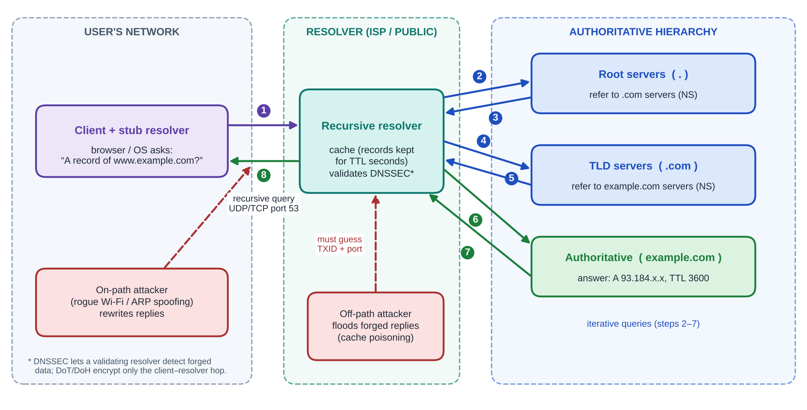

1. Your computer's **stub resolver** asks a **recursive resolver** (ISP, campus or public) for the address.
2. If the answer is not cached, the resolver asks the **root** servers, then the **.com** servers, then the
   domain's own **authoritative** server (*iterative queries*).
3. The resolver **caches** the answer for its **TTL** (time to live, in seconds) and returns it to you.

**Where spoofing happens:**

| Attacker position | How | What DNScope can see |
|---|---|---|
| **On-path** (between you and your resolver, e.g. a rogue Wi-Fi hotspot) | Rewrites replies in transit | Your system resolver disagrees with the public resolvers |
| **Off-path** (anywhere on the Internet) | Floods the resolver with forged replies, guessing the 16-bit transaction ID and source port, hoping one is accepted and cached | The poisoned resolver disagrees with the others until the TTL expires |
| **Registrar / authoritative server compromise** | Changes the real records | All resolvers agree on a new address; only history can hint at it |

**DNSSEC** adds digital signatures so validating resolvers can reject forged data. It only helps for signed
domains. **DoH/DoT** encrypt the hop between you and your resolver, but they do **not** prove the resolver's
answer is genuine.

---

## 4. System architecture

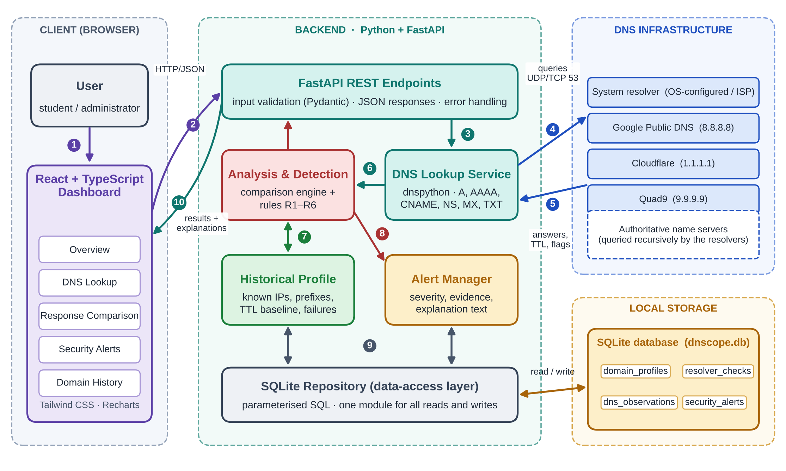

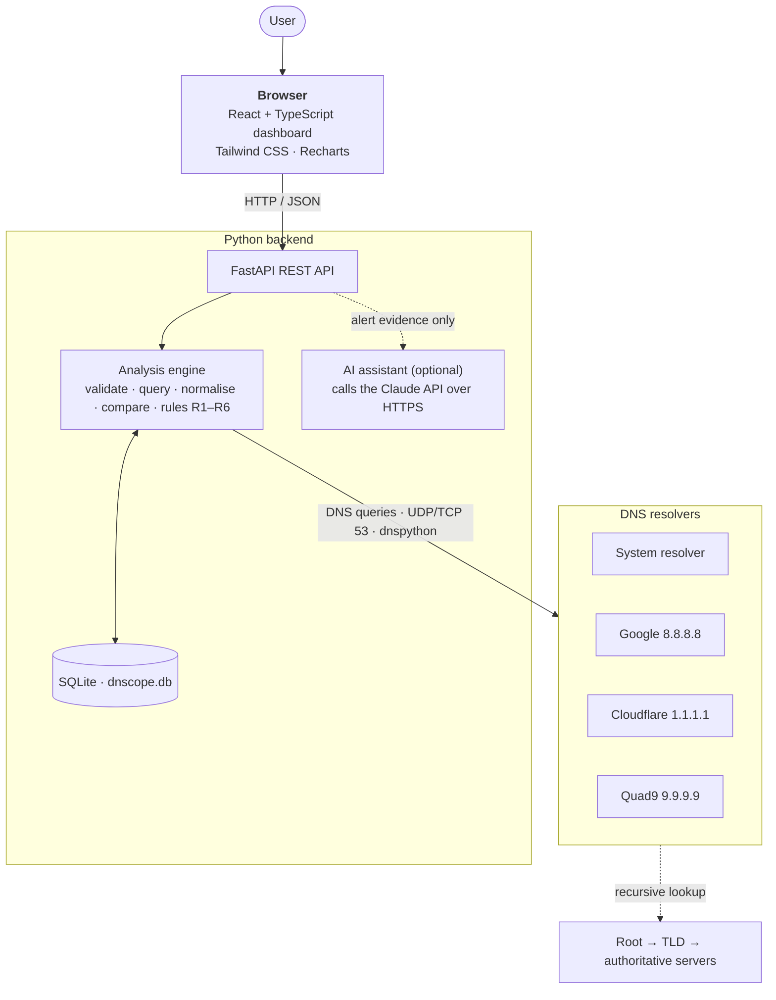

| Layer | Technology | Responsibility |
|---|---|---|
| Presentation | React 18, TypeScript, Tailwind CSS, Recharts | Five dashboard pages, charts, loading and error states |
| Application | Python, FastAPI, Pydantic | REST API, input validation, orchestrating each check |
| Network | dnspython | Builds DNS queries (RD = 1, EDNS(0) with DO bit), UDP with TCP fallback, parses flags and records |
| Data | SQLite (built-in `sqlite3`) | Domain profiles, resolver checks, observations, alerts |
| AI (optional) | Anthropic Claude API | Plain-language alert explanations; never decides alerts |

DNScope is an **active** measurement tool: it sends its own queries. It does **not** capture or inspect other
traffic on your network.

---

## 5. What happens during one check

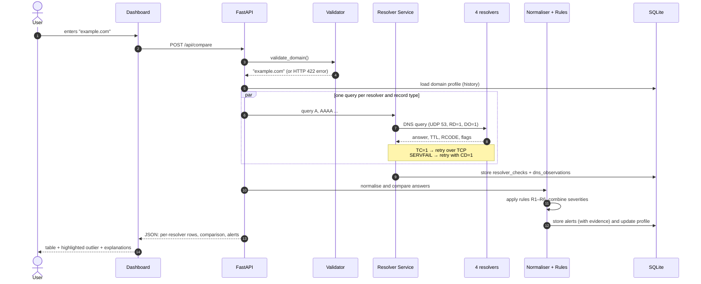

What is recorded for every response:

| Field | Meaning |
|---|---|
| **RCODE** | Result: `NOERROR`, `NXDOMAIN` (name does not exist), `SERVFAIL`, `REFUSED`, or timeout |
| **AA** | Authoritative answer |
| **TC** | Truncated; DNScope retries over TCP |
| **RA** | Recursion available |
| **AD** | Authenticated data; the resolver verified DNSSEC signatures |
| **TTL** | Seconds the answer may be cached (cached copies count down) |
| **Response time** | Round-trip time in milliseconds |

---

## 6. Detection rules R1–R6

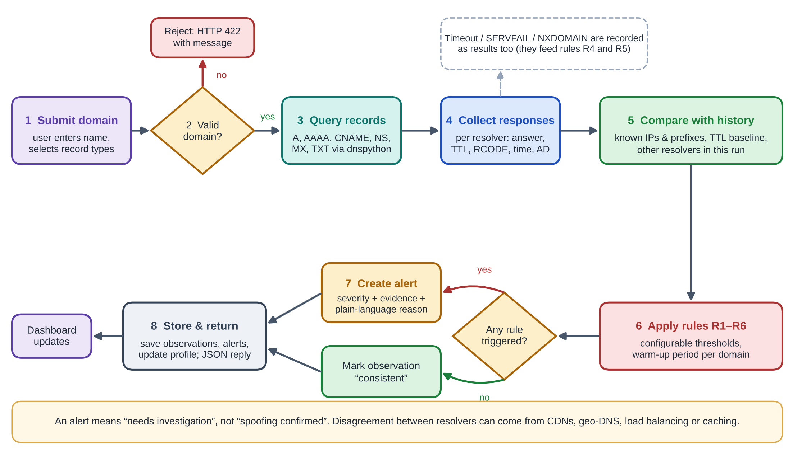

| Rule | Checks for | Base severity | Harmless causes it also considers |
|---|---|---|---|
| **R1** Unexpected address change | An address never seen for this domain **and** outside its usual `/24` (IPv4) or `/48` (IPv6) networks (after warm-up) | Low | Server migration, new CDN edges, round-robin pools |
| **R2** Resolver disagreement | One resolver shares no address or network with a majority of the others. Also flags ISP NXDOMAIN rewriting (Info). | Medium | CDN / geo-DNS steering, stale caches, filtering resolvers |
| **R3** Unusual TTL | Highest TTL in this check is below 0.1× or above 10× the domain's usual TTL (after warm-up) | Info | Operator lowered the TTL before a planned change |
| **R4** Repeated failures | 3 of the last 5 checks failed at every resolver, or a domain that used to resolve now returns NXDOMAIN | Low / Medium | Outage, expired domain, local network problem |
| **R5** DNSSEC failure | A validating resolver returns SERVFAIL but answers with the **CD** (checking disabled) bit set, or a signed domain loses the **AD** flag | High / Medium | Key-rollover mistake by the domain operator |
| **R6** Private address | A public name resolves to `10.x`, `172.16–31.x`, `192.168.x`, `127.x`, `169.254.x`, `100.64/10` or IPv6 equivalents | Medium / High | Split-horizon DNS inside organisations |

### How severities combine

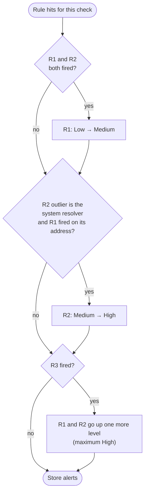

**Safeguards against false alarms:**

* **Warm-up:** R1 and R3 stay silent until a domain has 5 successful checks.
* **Prefix matching:** a new host in the same `/24` network counts as "same provider".
* **No majority, no alert:** if every resolver returns a different network (typical of CDNs), DNScope shows a
  note instead of an alert.
* **Outliers are not learned:** an address flagged by R2 is not added to the domain's baseline.
* **No duplicates:** an identical open alert is not raised twice.

---

## 7. Backend modules

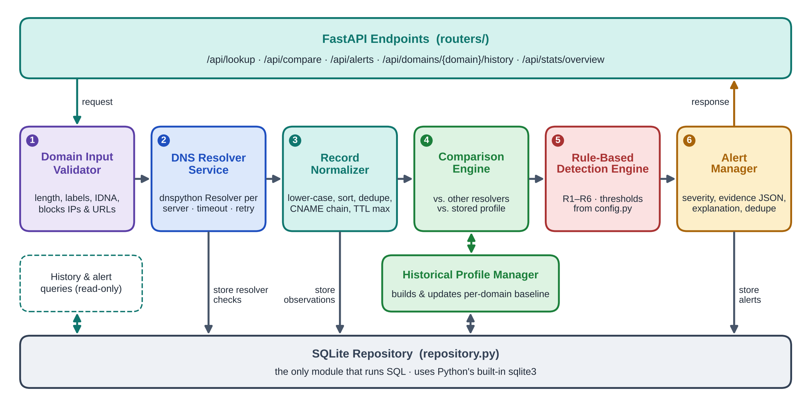

| # | Module | File | Job |
|---|---|---|---|
| 1 | Domain Input Validator | `validator.py` | Length and label checks, converts international names, rejects IPs and URLs |
| 2 | DNS Resolver Service | `resolver_service.py` | Sends queries (live with dnspython, or mock scenarios), records flags, TTLs and timing |
| 3 | Record Normaliser | `normalizer.py` | Follows CNAME chains, sorts answers, groups by network prefix, keeps the maximum TTL |
| 4 | Comparison Engine | `rules.py` → `compare()` | Finds agreement, outliers, or "all different" |
| 5 | Rule-Based Detection Engine | `rules.py` → `evaluate()` | Applies R1–R6 and combines severities |
| 6 | Alert Manager | `service.py` | Stores alerts with evidence and possible causes, skips duplicates |
| – | Historical Profile Manager | `rules.py` → `update_profile()` | Learns known addresses, networks, TTL baseline, DNSSEC status |
| – | SQLite Repository | `repository.py` | The only module that runs SQL (all queries parameterised) |
| – | AI Assistant | `ai_assistant.py` | Optional Claude explanation with rule-based fallback |
| – | API | `main.py` | FastAPI endpoints |

---

## 8. Database design

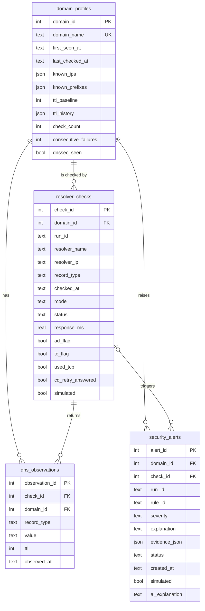

* One **run** = one click of *Check*. It creates one `resolver_checks` row per resolver per record type,
  all sharing a `run_id`.
* Every alert's `evidence_json` cites the exact `observation_id`s that triggered it, so each alert can be
  traced back to the raw DNS answers.
* To start with an empty database, stop the backend and delete `backend/dnscope.db`.

---

## 9. AI assistant (optional)

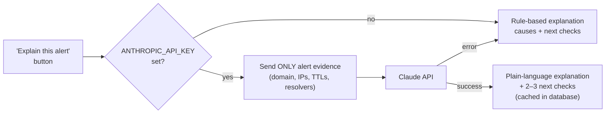

* **The AI never decides alerts.** Rules R1–R6 do. The AI only explains them.
* It is instructed never to call an alert confirmed spoofing, to weigh harmless causes, and to suggest
  concrete checks (for example `dig @8.8.8.8 example.com A +dnssec`).
* AI text is labelled as AI-generated because it can be wrong.
* **To enable it:** copy `backend/.env.example` to `backend/.env`, set `ANTHROPIC_API_KEY=...` and restart.
  The model is set by `DNSCOPE_AI_MODEL` (current model names: <https://docs.claude.com>).
* **Without a key** the button still works and shows the built-in explanation, so the project runs fully offline.

---

## 10. Dashboard pages

| Page | What you see |
|---|---|
| **1. Overview** | Total checks, domains, open alerts, resolver agreement %, 14-day activity chart, alerts by severity, recent alerts, one-click simulated scenarios |
| **2. DNS Lookup** | A, AAAA, CNAME, NS, MX and TXT records from all four resolvers, with TTL, RCODE, flags and response time |
| **3. Response Comparison** | Side-by-side answers, outlier highlighted in red, alerts with evidence, possible causes and AI explanation |
| **4. Security Alerts** | Filterable alert list, full investigation panel, mark reviewed or dismissed |
| **5. Domain History** | Addresses over time (unknown ones in red), TTL trend chart, known networks, past alerts |

All numbers are computed live from the database. Nothing on the dashboard is hard-coded.

<table>
<tr>
<td>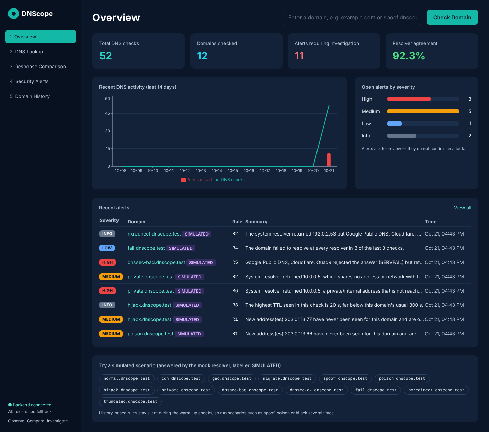<p align="center"><b>Overview</b></p></td>
<td>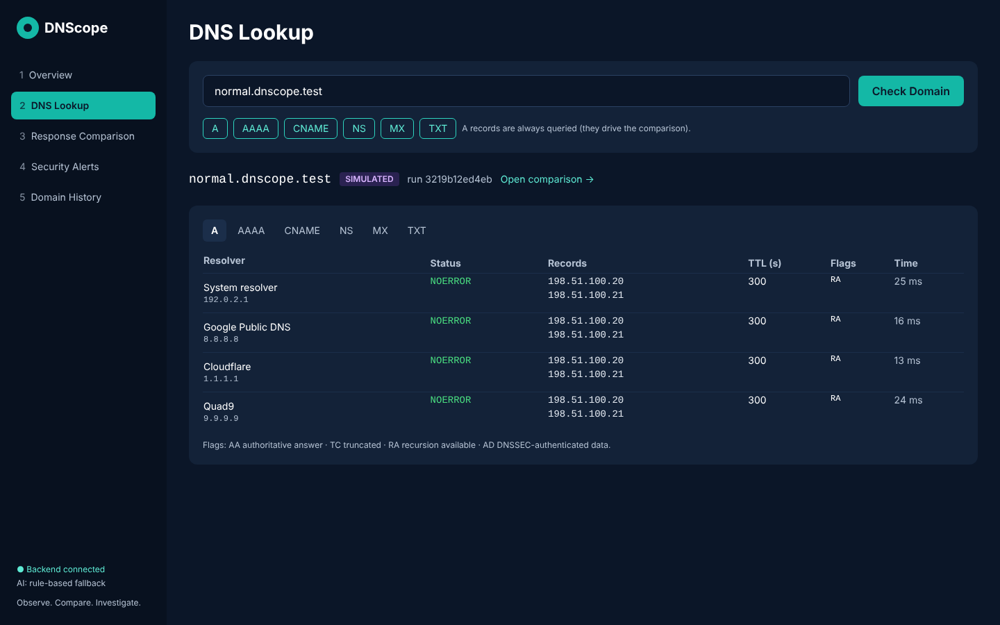<p align="center"><b>DNS Lookup</b></p></td>
</tr>
<tr>
<td>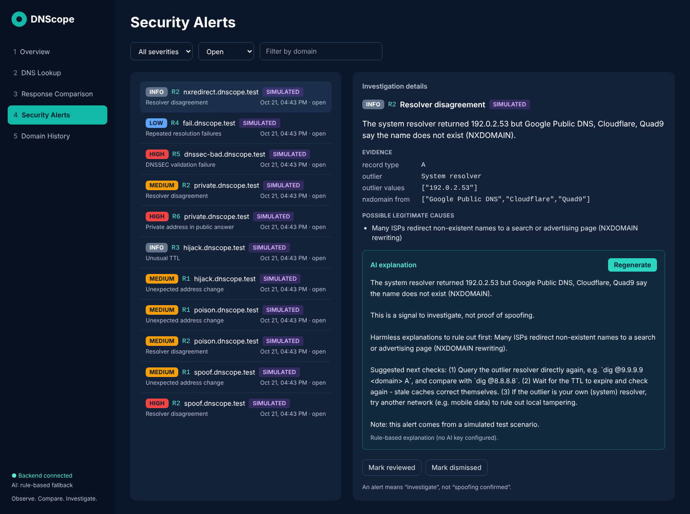<p align="center"><b>Security Alerts</b></p></td>
<td>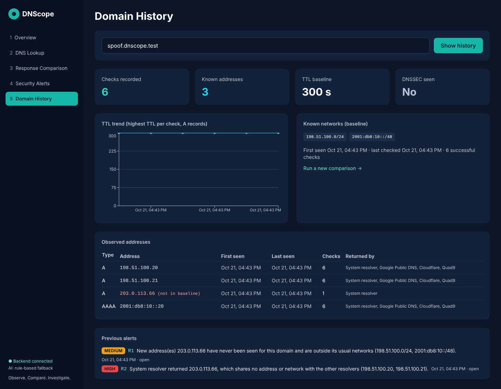<p align="center"><b>Domain History</b></p></td>
</tr>
</table>

---

## 11. Simulated test scenarios

Attacks cannot ethically be created on real resolvers, so domains under **`dnscope.test`** are answered by a
built-in **mock resolver** and always labelled **SIMULATED**. (`.test` is reserved by RFC 6761 and never
resolves on the Internet. All addresses come from documentation ranges.)

| Domain | Simulates | Expected result |
|---|---|---|
| `normal.dnscope.test` | All resolvers agree | No alert |
| `cdn.dnscope.test` | Different hosts in the same `/24` | No alert |
| `geo.dnscope.test` | Every resolver gets a different network | No alert ("all different" note) |
| `migrate.dnscope.test` | Moves to a new host in the same network | No alert |
| `spoof.dnscope.test` | Your **system resolver** returns an unrelated address | **R2 High** + R1 Medium |
| `poison.dnscope.test` | **Quad9** returns an unrelated address | R2 Medium + R1 Medium |
| `hijack.dnscope.test` | **All** resolvers move to a new network with a 20 s TTL | R1 Medium + R3 Info |
| `private.dnscope.test` | System resolver returns `10.0.0.5` | **R6 High** |
| `dnssec-bad.dnscope.test` | Broken DNSSEC signatures | **R5 High** |
| `dnssec-ok.dnscope.test` | Valid DNSSEC (AD flag) | No alert |
| `fail.dnscope.test` | Every resolver times out | R4 after 3 checks |
| `nxredirect.dnscope.test` | ISP rewrites NXDOMAIN to an address | R2 Info |
| `truncated.dnscope.test` | Large TXT answer | TCP retry shown |

`spoof`, `poison`, `hijack` and `migrate` behave normally for the first 5 checks (warm-up), then change, so
check them 6 times or run `python -m app.seed_demo`.

**Suggested demo:** check `normal.dnscope.test` (four green "agrees"), then `spoof.dnscope.test` (outlier in
red, High alert), then click **Explain this alert**.

---

## 12. API reference

Full interactive documentation runs at `http://localhost:8000/docs`.

| Method | Endpoint | Purpose |
|---|---|---|
| `POST` | `/api/lookup` | Full check; records grouped by type |
| `POST` | `/api/compare` | Query all resolvers and compare A or AAAA |
| `GET` | `/api/alerts?severity=&status=&domain=` | List alerts |
| `GET` | `/api/alerts/{id}` | Alert detail with evidence |
| `PATCH` | `/api/alerts/{id}` | Set status: `open`, `reviewed` or `dismissed` |
| `POST` | `/api/alerts/{id}/ai-explanation` | Plain-language explanation (AI or rule-based) |
| `GET` | `/api/domains/{domain}/history` | Addresses over time, TTL series, past alerts |
| `GET` | `/api/stats/overview` | Dashboard numbers |
| `GET` | `/api/health` · `/api/ai/status` · `/api/scenarios` | Status and demo scenarios |

Example:

```bash
curl -X POST http://localhost:8000/api/compare \
     -H "Content-Type: application/json" \
     -d '{"domain": "spoof.dnscope.test", "record_type": "A"}'
```

---

## 13. Configuration

Copy `backend/.env.example` to `backend/.env`. Every value is optional.

| Setting | Default | Meaning |
|---|---|---|
| `DNSCOPE_RESOLVER_MODE` | `live` | `mock` answers every domain from scripted scenarios (fully offline) |
| `DNSCOPE_QUERY_TIMEOUT` | `2.0` | Seconds to wait per query |
| `DNSCOPE_WARMUP_CHECKS` | `5` | Checks before R1 / R3 become active |
| `DNSCOPE_TTL_LOW_RATIO` / `HIGH_RATIO` | `0.1` / `10` | R3 thresholds |
| `DNSCOPE_FAIL_COUNT` / `FAIL_WINDOW` | `3` / `5` | R4: failures out of recent checks |
| `ANTHROPIC_API_KEY` | *(empty)* | Enables AI explanations |
| `DNSCOPE_AI_MODEL` | `claude-haiku-5-5` | Model used for explanations |

Resolvers and network prefix sizes are in `backend/app/config.py`.

**Calibrating thresholds:** check about 30 popular domains, including CDN-heavy sites, several times over a
few days with no simulated attacks. Every alert on that set is a false positive. Adjust the warm-up length,
TTL ratios and failure window until false positives are acceptable while the simulated scenarios still trigger.

---

## 14. Testing

```bash
cd backend
pytest -q
```

**41 tests** cover input validation, normalisation (CNAME chains, prefixes, private ranges), every simulated
scenario, all API endpoints, and the AI path (with the Claude call stubbed, so no key or network is needed).

**Planned evaluation metrics:**

| Metric | Formula | Question it answers |
|---|---|---|
| Precision | TP / (TP + FP) | Of the alerts raised, how many were warranted? |
| Recall | TP / (TP + FN) | Of the cases that should alert, how many did? |
| False-positive rate | FP / (FP + TN) | How often are normal domains wrongly flagged? |
| Detection latency | time from query to alert | How fast is a check? (median and 95th percentile) |

TP/FP/TN/FN = true/false positives/negatives. Recall on simulated scenarios is not real-world performance,
because the scenarios were designed with the rules in mind.

---

## 15. Limitations

* DNScope only sees **its own queries**. Encrypted DNS (DoH/DoT) used by browsers is invisible to it.
* CDN and geo-DNS behaviour still causes some false alarms; calibration reduces but cannot remove them.
* A poisoned cache entry may expire before a check runs, or appear after it.
* If the domain's real server or registration is hijacked, **every** resolver agrees. Only history (R1) can
  hint at it, and it looks like a legitimate migration.
* DNSSEC checks (R5) only apply to signed domains.
* Some networks (including some campus and cloud networks) intercept all DNS traffic, so the four "independent"
  resolvers may effectively be one. Compare results on a second network if in doubt.
* DNScope **cannot detect every DNS spoofing attack**, and its alerts are prompts to investigate, not proof.

---

## 16. Project structure

```
dnscope/
├── README.md
├── backend/
│   ├── requirements.txt
│   ├── .env.example
│   ├── app/
│   │   ├── main.py              FastAPI endpoints
│   │   ├── config.py            resolvers, thresholds, AI settings
│   │   ├── validator.py         domain input validator
│   │   ├── resolver_service.py  live dnspython queries + mock scenarios
│   │   ├── normalizer.py        CNAME chains, prefixes, max TTL, private ranges
│   │   ├── rules.py             comparison, rules R1–R6, profile learning
│   │   ├── service.py           runs one complete check
│   │   ├── repository.py        SQLite (only module with SQL)
│   │   ├── ai_assistant.py      optional AI explanations + fallback
│   │   └── seed_demo.py         fills the database with simulated data
│   └── tests/                   41 pytest tests
├── frontend/
│   ├── package.json · vite.config.ts · tailwind.config.js
│   └── src/
│       ├── App.tsx              layout + navigation
│       ├── api.ts · types.ts    typed API client
│       ├── components/ui.tsx    badges, cards, alert detail, AI panel
│       └── pages/               Overview, Lookup, Compare, Alerts, History
└── docs/
    ├── DNScope_Computer_Networks_Assessment_8.pdf      project report
    ├── DNScope_Computer_Networks_Presentation.pptx     slides (+ PDF)
    ├── images/                                         architecture diagrams
    └── screenshots/                                    dashboard screenshots
```

---

## 17. References

* RFC 1034 / RFC 1035: Domain Names, concepts and implementation
* RFC 3833: Threat Analysis of the Domain Name System
* RFC 5452: Measures for Making DNS More Resilient against Forged Answers
* RFC 4033 / 4034 / 4035: DNS Security Extensions (DNSSEC)
* RFC 6891: Extension Mechanisms for DNS (EDNS(0))
* RFC 7766: DNS Transport over TCP
* RFC 7858 / RFC 8484: DNS over TLS / DNS over HTTPS
* RFC 1918: Address Allocation for Private Internets · RFC 5737: IPv4 Documentation Addresses · RFC 6761: Special-Use Domain Names
* dnspython documentation: <https://dnspython.readthedocs.io/>
* FastAPI documentation: <https://fastapi.tiangolo.com/>

The full literature review and design discussion are in the project report in `docs/`.
